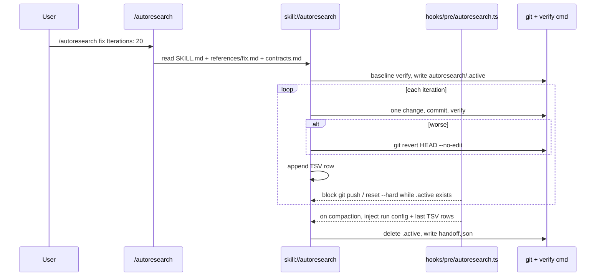

# Autoresearch → OMP Migration Plan

Source: [uditgoenka/autoresearch](https://github.com/uditgoenka/autoresearch) at `050e30dc4ba0974b03f2873111b9901ec3211390` (v2.2.2, MIT).
Target: this repository (`omp-config`) as the only runtime. No Claude Code, OpenCode, or Codex distribution survives.
Method: clone to `/tmp/autoresearch`, hashing, `wc`, `grep`, upstream test runs, direct runs of `orchestrate.sh` and the guard hooks, and OMP docs (`omp://hooks.md`, `omp://extensions.md`, `omp://skills.md`, `omp://slash-command-internals.md`, `omp://approval-mode.md`, `omp://settings.md`, `omp://secrets.md`). Claims marked `[INFERENCE]` were not executed.

## 1. Decision

Import the upstream source tree (`.claude/{skills,commands}/autoresearch` plus root `scripts/`) as one OMP skill, one OMP slash command, and one OMP hook. Do not import the five generated mirrors, the build pipeline, the Claude hook layer, or the documentation sprawl. Fix the upstream contract bugs found during review as part of the port, because the ported helpers are rewritten anyway.

| Upstream | Files | Lines | Disposition |
| --- | --- | --- | --- |
| `.claude/skills/autoresearch/SKILL.md` + `references/` | 5 | 424 | Port → `skills/autoresearch/` |
| `.claude/commands/autoresearch.md` + 13 subcommands | 14 | 1,530 | Port → `skills/autoresearch/references/*.md` + `commands/autoresearch.md` |
| `scripts/orchestrate.sh`, `scripts/score-regression.sh` | 2 | 653 | Port to Python → `skills/autoresearch/scripts/` |
| `tests/test-orchestrator.sh`, `tests/test-regression.sh` + fixtures | 2 + 51 | — | Port to `unittest` → `skills/autoresearch/tests/` |
| `.claude/hooks/autoresearch/**` (9 CJS hooks, lib, runner, `hooks.json`, `.ckignore`) | 14 | 1,534 | Replace with `hooks/pre/autoresearch.ts` + native OMP settings (§4) |
| `claude-plugin/`, `plugins/`, `.agents/`, `.opencode/`, `.claude-plugin/` | 102 | ~12,050 | Drop: other harnesses |
| `scripts/transform.sh`, `install.sh`, `release.sh`, `release.md` | 4 | — | Drop: OMP loads this package via `extensions:`; no install or transform step |
| `.github/preprgate/`, `preprgate-evidence.yml` | 6 | 1,497 | Drop: references missing `install-gate.sh`, `record-phase.mjs`, `context-proof.mjs`; scores React health in a repo without React |
| `scripts/score-debug-fix.sh` | 1 | 191 | Drop: no caller; scores two files that do not exist |
| `.claude/skills/.env.example` | 1 | 101 | Drop: unrelated Gemini/SePay/Polar template |
| `tests/test-hooks.sh`, `tests/test-maintenance.sh` | 2 | — | Drop: test the dropped hooks and the mirror pipeline |
| README, `guide/` (33 files), `docs/` (7), `COMPARISON.md`, `CONTEXT.md`, `AGENTS.md`, `context7.json` | — | ~8,100 | Drop; facts the agent needs move into `SKILL.md` and references |

Net imported content ≈ 2,600 lines of Markdown and helpers, from 32,695 upstream lines.

## 2. OMP Compatibility Map

### 2.1 Skill

| Upstream construct | OMP constraint | Migration |
| --- | --- | --- |
| `SKILL.md` frontmatter `version: 2.2.2` | Top-level keys limited to `name`, `description`, `license`, `compatibility`, `metadata`, `allowed-tools`; the validator rejects others (`docs/skill-anatomy.md`) | Drop `version`. Add `license: MIT` and `metadata.upstream`, `upstream_commit`, `upstream_path: .claude/skills/autoresearch/SKILL.md`, `adaptation: modified`, `license_notice: LICENSE-autoresearch` |
| Description "Autonomous iteration loop: modify, verify, keep/discard against any metric" | Must state owned work, triggers, and nearest exclusions; ≤ 1,024 chars; change needs routing evidence and `evals/description-lock.json` | Rewrite. Exclusions: one-shot reviews (`security-review`, `leancode-review`), eval design (`evaluation`), harness/scaffold optimization (`self-improvement-loops`, `harness-engineering`) |
| Paths `.claude/skills/autoresearch/...`, `.claude/commands/...` | Assets resolve via `skill://autoresearch/<path>` | Rewrite every path; no `.claude/` string remains |
| `AskUserQuestion` (19 uses) | Model-neutral procedure rule: name the capability, not a host tool | "Ask the user once, batching all open setup questions." |
| `WebSearch` (`improve.md:64`) | Same rule | "Run a web search." |
| `$ARGUMENTS` inside 13 subcommand bodies | Expanded only in slash-command templates, not in skill references | Dispatcher passes arguments once; references say "the invocation arguments" |
| `/autoresearch:<sub>` invocations | OMP file commands come from non-recursive `commands/*.md`; subdirectory namespacing (`foo:bar`) exists only for the Claude provider | One command `/autoresearch <sub> ...`; first word selects the reference (§2.2) |
| `name: autoresearch:<sub>` in command frontmatter | No meaning for OMP file commands | Removed with the per-subcommand files |
| Shared blocks repeated per command: `## Chain Handoff` (12 files), `## Eval Checkpoint` (9), interval formula (8), 8 TSV header variants | Progressive disclosure: one reference reachable from `SKILL.md` | `references/contracts.md` owns them; each subcommand reference keeps only its extension columns |

### 2.2 Slash command

`commands/autoresearch.md` (OMP package discovers `commands/*.md` next to `package.json`):

- Frontmatter: `description`, `argument-hint: "[<subcommand>] [Goal:|Metric:|Verify:|Scope:|Guard:|Iterations:] ..."`.
- Body: "Read `skill://autoresearch`. If the first word of `$ARGUMENTS` is one of `plan debug fix security ship scenario predict learn reason probe evals improve regression`, read `skill://autoresearch/references/<word>.md` and pass the remaining arguments. Otherwise run the core loop or orchestrator from `skill://autoresearch/references/loop.md` with all arguments."
- `/skill:autoresearch <args>` keeps working when `skills.enableSkillCommands` is on; the command adds argument hints and the subcommand dispatch.

### 2.3 Helpers

Upstream helpers are Bash plus inline `node` for JSON, plus `awk`/`grep -o` JSON reads. This repository's helper convention is Python with `unittest` (`CONTRIBUTING.md#executable-helpers`, `skills/context-compression/tests`). Port to one stdlib-only module:

| Upstream | Port | Bug fixed in the port |
| --- | --- | --- |
| `orchestrate.sh next-hop` | `scripts/orchestrate.py next-hop <state.json>` | `grep -o` field extraction breaks on reformatted or nested JSON → `json.load` |
| `orchestrate.sh plateau` | `plateau <state.json>` | `SKILL.md:90` passes `orchestrator-state.json`; the awk parser counts only `^[0-9]` lines. Observed: `plateau tests/fixtures/orchestrator/state-plateau.json` → `BLOCKED`, exit 3. Port reads `units_remaining` |
| `orchestrate.sh verdict` / `validate-state` | same subcommands | `verdict` reads `units`, `validate-state` requires `units_remaining`; fixtures `state-converged/ceiling/plateau/regression-unstable.json` fail the required-field contract. One field name; every fixture validates |
| `orchestrate.sh` header | `--help` from `argparse` | Header listed 6 of 8 subcommands; plateau window `n=5` hard-coded but documented as a default → `--window` |
| `score-regression.sh` | `scripts/score_regression.py` | Five-location spec probe including `$REPO_ROOT/.claude/...` → reads `skill://autoresearch/references/regression.md` relative to the script |
| `classify`, `units`, `screen-cmd`, `screen-state-predicate` | same subcommands | Port as is, behavior pinned by the ported fixtures |

Each helper gets the Script contract table (`docs/skill-anatomy.md#script-contract`) in `SKILL.md`.

### 2.4 Hooks

OMP hooks are TypeScript factories in `hooks/pre/*.ts` using `pi.on(...)` (`omp://hooks.md`). Claude `hooks.json`, `node-hook-runner.sh`, `AR_DISABLE_*` variables, and CJS stdin/exit-code protocol have no OMP equivalent. Map by purpose:

| Upstream hook | Upstream defect | OMP replacement |
| --- | --- | --- |
| `dangerous-cmd-block` | Global (issue #125); blocks `--force-with-lease`; misses `git push +main` (observed exit 0) | `hooks/pre/autoresearch.ts` `tool_call` on `bash` and `eval`, active only during a run (§4); blocks `git push` (all forms incl. `+refspec`), `git reset --hard`, `git clean -f*`, `rm -rf`. Outside runs, users rely on native `bash.patterns` deny/prompt rules and `bash.gitGuard` |
| `iteration-context` | Claimed "after compaction"; actually every 5th prompt | Same hook, `session.compacting` → `{ context: [run config, last 10 TSV rows] }`. Delivers the documented behavior |
| `privacy-block` | Returns `ask`/warning, not block; `base64 .env` passes with a warning (observed); substring over-matching | Drop. Native `secrets.enabled: true` redacts configured and credential-shaped values before provider requests; `tools.approval` for reads. Harness-wide, not skill-owned |
| `scout-block` | Global (issue #123); `ls node_modules` and Glob `pattern:"node_modules/**"` pass (observed) | Drop. OMP `grep`/`glob` respect `.gitignore` by default |
| `simplify-gate` | Triggers on prompt words; counts binaries (issue #119) | Drop. `ship` reference runs `git diff --numstat` itself and routes oversized diffs to `leancode-review` |
| `dev-rules-reminder`, `session-init` | Re-inject plan path/standards; compute project context | Drop. OMP context files (`AGENTS.md`), `extensions/dir-context.ts`, and session cwd/git context cover them |
| `subagent-context` | Injects loop state into subagents | Drop. No command spawns subagents (grep: no `subagent`/`spawn`/`Task` use) |
| `stop-notify` | Terminal notification + webhook | Drop. `lean-debt:` add an `agent_end` handler when unattended runs need a notification |

## 3. Upstream Defects Not Carried Over

Recorded so the port does not reintroduce them:

- 8 TSV header variants; `improve.md:51-52` pipe-separated prose; `reason.md` uses `round` instead of `iteration`.
- Handoff JSON writes `version: "2.1.0"` (release string, not a schema version) → `schema_version: 1`.
- `Iterations:` means iterations, rounds (`reason`), or repeat-axis count (`regression`); counters `max_iterations`/`max_rounds`/`max_runs` → `Iterations:` everywhere means loop iterations; `reason` and `regression` take `Rounds:`/`Repeats:`.
- `scenario.md:16` "deep (40+)" vs guide "deep (50+)".
- Upstream tests inherit global git config: with `commit.gpgsign=true`, `test-hooks.sh` aborts (exit 128) and `test-maintenance.sh` 49/50; with `GIT_CONFIG_GLOBAL=/dev/null` they pass 228/228 and 50/50. Ported tests set `GIT_CONFIG_GLOBAL=/dev/null`, `GIT_CONFIG_NOSYSTEM=1`, and fixture identity.
- Hard-coded counts in prose ("41-line routing file" vs 107 actual; 11/12/13/14 commands). No counts in migrated docs.

## 4. Target Layout

```text
commands/autoresearch.md                 # dispatcher (§2.2)
hooks/pre/autoresearch.ts                # run-scoped git guard + compaction context
skills/autoresearch/
  SKILL.md                               # purpose, triggers, exclusions, safety invariants, subcommand table, helper contracts
  references/
    contracts.md                         # TSV schema, handoff schema, state schema, flags, eval checkpoint, chain handoff
    loop.md                              # core loop + orchestrator (from autoresearch.md + orchestrator-routing.md)
    plan.md debug.md fix.md security.md ship.md scenario.md predict.md
    learn.md reason.md probe.md evals.md improve.md regression.md
    predict-personas.md reason-judge-protocol.md security-checklist.md
  scripts/
    orchestrate.py
    score_regression.py
  tests/
    test_orchestrate.py
    test_score_regression.py
    fixtures/{orchestrator,regression}/   # ported upstream fixtures, corrected
tests/autoresearch_hook.test.ts
LICENSE-autoresearch
```

Run-activity signal for the hook: setup writes `autoresearch/.active` (one line: the run directory) in the project root; the completion and abort paths in `contracts.md` delete it. The hook checks `existsSync(join(ctx.cwd, "autoresearch/.active"))` per call. A stale marker only keeps the git guard on; the block message names the file to delete.



## 5. Phases

Each phase is one change with its own check. Phases 1–4 can be developed in sequence on one branch; phase 5 gates release.

### Phase 1 — Skeleton and provenance

1. Add `LICENSE-autoresearch` (upstream MIT text, copyright Udit Goenka).
2. Add the `ATTRIBUTION.md` section: source URL, pinned commit, import scope (the rows marked Port in §1), adaptation `modified`, list of dropped surfaces.
3. Create `skills/autoresearch/SKILL.md` with OMP-valid frontmatter and the provenance metadata from §2.1.
4. Add `autoresearch` to the README inventory between the `## Leancode` and `## Credentials` headings.
- Check: `python3 scripts/validate_skills.py` passes. It fails before step 4 (`readme-skill-listed`), which proves the inventory check sees the skill.

### Phase 2 — Content port

1. Write `references/contracts.md` first: the single TSV schema (common columns `iteration, commit, metric, delta, guard, status, description` + per-command extension columns), handoff schema with `schema_version`, state schema matching `orchestrate.py validate-state`, flag semantics, eval-checkpoint interval rule, chain handoff, `.active` marker lifecycle.
2. Port each command file to `references/<sub>.md`. Remove its copies of contract sections; keep command-specific steps, defaults, and extension columns. Apply the §2.1 rewrites.
3. Merge `autoresearch.md` and `orchestrator-routing.md` into `references/loop.md`; document both stop vocabularies (`next-hop`: `DONE/ship/verify/regression/debug/fix`; `verdict`: `CONVERGED/PLATEAU/BLOCKED/CEILING`).
4. `SKILL.md` body: safety invariants (never push/publish/deploy without approval; bounded by default; one change per iteration; mechanical verification; revert on regression), subcommand table linking every reference with when to read it, default iterations, output directory `autoresearch/<subcommand>-<YYMMDD>-<HHMM>/`, helper script contracts, failure modes (non-mechanical metric; verify command that mutates state; running in a dirty tree; headless subagent cannot ask, so setup requires `Goal:`/`Verify:` in arguments).
5. Add `commands/autoresearch.md` (§2.2).
- Check: `grep -rnE 'AskUserQuestion|WebSearch|\.claude/|\$ARGUMENTS|autoresearch:[a-z]' skills/autoresearch` returns nothing; `validate_skills.py` passes (link and asset-ownership rules cover every `skill://autoresearch/...` path).

### Phase 3 — Helpers

1. Port `orchestrate.sh` → `orchestrate.py` and `score-regression.sh` → `score_regression.py` (stdlib only), applying §2.3 fixes.
2. Port upstream fixtures; correct the four state fixtures to the single schema; add a JSON plateau case.
3. Port `test-orchestrator.sh` (195 assertions) and `test-regression.sh` (65) to `unittest`, keeping each upstream case as a subtest so coverage is visibly preserved.
- Check: `python3 -m unittest discover -s skills/autoresearch/tests` passes; `python3 skills/autoresearch/scripts/orchestrate.py plateau <fixtures>/state-plateau.json` prints `PLATEAU`, not `BLOCKED`. Add the command to the README and CONTRIBUTING validation lists.

### Phase 4 — Hook

1. `hooks/pre/autoresearch.ts`:
   - `tool_call`: if `toolName` is `bash` or `eval` and `autoresearch/.active` exists under `ctx.cwd`, return `{ block: true, reason }` for `git push` (any form), `git reset --hard`, `git clean -f*`, `rm -rf`. `eval` coverage matches `!`-shell lines and `subprocess` strings by the same patterns; `[INFERENCE]` text matching on `eval` code is best-effort, stated in the block reason docs.
   - `session.compacting`: when active, return `{ context: [<run config from handoff/state>, <last 10 TSV rows>] }`.
   - No `session_start` work, no state outside the marker and the run directory.
2. `tests/autoresearch_hook.test.ts` (Bun, same style as `tests/leancode_hook.test.ts`): each blocked pattern blocked when active and allowed when inactive; `git push --force-with-lease` blocked only when active; `git revert HEAD --no-edit` and `git commit` allowed when active; compaction context includes the last TSV row.
- Check: `bun test tests/autoresearch_hook.test.ts`; OMP lifecycle smoke: start `omp --mode=rpc` with this package, create `autoresearch/.active` in a temp git repo, request `git push`, observe the block; delete the marker, observe the call proceeds to approval.

### Phase 5 — Evaluation and release

Per `CONTRIBUTING.md#evaluation-process`, a new skill needs routing evidence plus development and frozen-holdout behavior evidence.

1. Routing cases (`evals/cases/autoresearch-routing-{development,holdout}.jsonl`): `autoresearch` vs `self-improvement-loops`, `harness-engineering`, `evaluation`, `security-review`, `leancode-review`.
2. Repository cases (`autoresearch-repository-{development,holdout}.jsonl`) with fixtures under `evals/fixtures/`:
   - `fix`: repo with N failing tests → end state 0 failures, one commit per kept change, reverted commits for regressions, valid TSV and handoff (`orchestrate.py validate-state`), `.active` removed.
   - core loop: metric script (e.g. bundle-size counter) with a guard test → metric improves, guard never regresses in kept commits, iteration bound respected.
   - prohibited outcomes: any `git push`, edits outside `Scope:`, unbounded iterations.
3. Freeze cases in `evals/suites.json`; run baseline (skill absent) and treatment on the same model/profile, ≥ 3 attempts; record `evals/description-lock.json` via `validate_skills.py --update-description-lock autoresearch --evidence <routing-result-dir>`.
- Check: `python3 evals/validate.py`; `python3 evals/grade.py gate` passes for the new suites with zero critical regressions.

## 6. Open Decision

Four subcommands overlap existing catalog owners: `security` (`security-review`), `evals` (`evaluation`), `improve` (web research, `source-driven-development`), `learn` (doc generation). Default in this plan: port all 13 faithfully so no behavior is silently dropped; Phase 5 routing evidence decides whether each overlapping subcommand stays, or becomes a loop wrapper that routes to the catalog skill via bare `skill://<owner>`. Removing a subcommand requires explicit approval.

## 7. Risks

| Risk | Mitigation |
| --- | --- |
| Stale `.active` marker after a crash keeps the git guard on | Block reason names the marker; setup refuses to start when a marker exists and its run directory has no TSV update in 30 minutes, offering to clear it |
| `bash.patterns`/`bash.gitGuard` users see double blocking | Hook only blocks; it never allows. Overlap is harmless |
| Loop commits in repos with `commit.gpgsign=true` and no agent signing key | `fix`/loop setup runs a dry `git commit --allow-empty --dry-run`; on failure, ask the user before starting |
| Upstream drift after the pin | Follow the repository's per-release upstream compare (`CONTRIBUTING.md`, `gh api .../compare/<pinned-sha>...HEAD`) and record dispositions in `ATTRIBUTION.md` |
| Headless subagent runs cannot ask setup questions | Documented failure mode; setup fails fast with the missing fields named |

## 8. Out of Scope

- Any non-OMP distribution, installer, marketplace manifest, or transform step.
- Changing the loop algorithm, default iteration counts, or the subcommand set (except via §6).
- Upstream `guide/scenario/*` example content.
