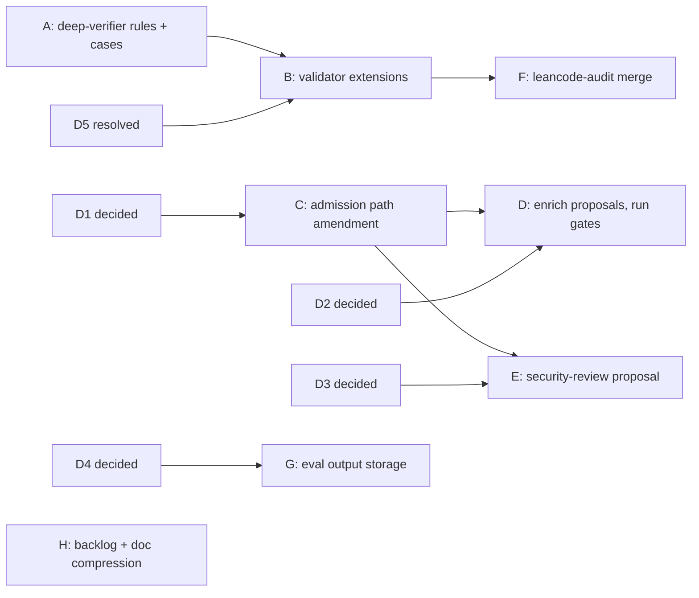

# ECC Comparison Improvement Plan

## 1. Purpose

This plan records what this repository should adopt from, and avoid in, the ECC catalog (`affaan-m/ECC`). It adds work items only where ECC shows a mechanism or skill content that this repository lacks. It does not replace `docs/skill-set-improvement-plan.md` or `docs/skill-content-refresh-plan.md`. Where an item would change a decision recorded in those plans, this plan names the section to amend and treats the amendment as an open decision (§11).

Source pin: `https://github.com/affaan-m/ECC` at commit `4eb71d92a39cab44ad40ac9d8a6a5ccb4029d6c2` (2026-10-09, `VERSION` 2.2.3), MIT License, © 2026 Affaan Mustafa. ECC paths below are relative to that commit.

## 2. Summary

ECC is broad and weakly governed. This repository is narrow and strongly governed. ECC provides 302 skills, 71 agents, and 95 commands. Its skill quality gate is a "Tested with Claude Code" checklist item (`CONTRIBUTING.md:160-172`), and its frontmatter validator only warns unless `CI_STRICT_SKILLS=1` is set (`scripts/ci/validate-skills.js:1-25`). This repository has spec-only frontmatter, skill-local references, and frozen routing and behavior holdouts.

The most useful changes, in order:

1. Add ECC's anti-noise reviewer rules to `agents/deep-verifier.md` (Workstream A).
2. Extend `scripts/validate_skills.py` to check agents, command cross-references, and description changes (Workstream B).
3. Add a second admission path so that procedural skills can pass the gates (Workstream C).
4. Use ECC content to strengthen two existing proposals before their treatment freeze (Workstream D).
5. Reduce tracked evaluation output and planning-document weight (Workstreams G and H).

ECC's structure is not a model for this repository. Its install manifests, per-harness skill copies, instinct pipeline, and framework-specific skill variants solve multi-harness distribution, which this repository does not have.

## 3. Baseline Measurements

Measured on 2026-10-10.

| Metric | ECC | This repository |
|---|---:|---:|
| Skills | 302 | 25 active, 3 proposals |
| `SKILL.md` lines, min / median / p90 / max | 34 / 190 / 514 / 950 | 49 / 249 / 319 / 422 |
| Skills with `references/` | 13 | 18 of 25 have `references/` or `scripts/` |
| Skills with `scripts/` | 15 | 12 helper scripts, 1 tested (`context-compression`) |
| Routing or behavior holdouts | none found | yes; `catalog-routing-home-v1` 102/102 |
| Total frontmatter description characters | not measured | 10,626 |
| Tracked `docs/` size | — | 248,846 bytes in 7 files |
| Tracked `evals/results` | — | 1,138 files, 56 MB |
| `evals/results` on disk, including ignored `artifacts/` | — | 16 GB |

Descriptions longer than 590 characters: `leancode` 937, `long-horizon-prompting` 851, `self-improvement-loops` 740, `context-fundamentals` 696, `simplified-engineering-english` 664, `project-development` 595.

## 4. Scope and Constraints

In scope: agent prompts, the validator, admission rules, proposal content, test coverage, evaluation-output storage, and planning documents.

This plan keeps every invariant in `docs/skill-set-improvement-plan.md` §3.3. In particular:

- Invariant 2 (references stay inside the owning skill). The two `multi-agent-research-evidence.md` files in `skills/evaluation/references/` and `skills/multi-agent-patterns/references/` are intentional skill-local copies. They differ in 10 lines. No deduplication.
- Invariant 9 (evaluator changes freeze before treatment). Every new behavior case in this plan is a separate pre-treatment change.
- Invariant 10 (historical evidence is preserved). Workstream G moves raw captures; it does not delete them.

Non-goals, from `docs/skill-set-improvement-plan.md` §3.2 and ECC's weaknesses:

- no wholesale import, and no per-framework skill variants (ECC repeats patterns/tdd/verification/security per stack);
- no session hooks, instinct pipeline, or always-loaded rules (`skills/continuous-learning-v2/`, `rules/`);
- no install profiles or module manifests (`manifests/install-*.json`);
- no per-harness skill copies (`.agents/skills/*/agents/openai.yaml`, synced by hand per `CONTRIBUTING.md:413-426`);
- no tests that assert prompt wording (ECC's `tests/ci/code-reviewer-false-positive-guard.test.js` pattern);
- no hard-coded counts in documentation (ECC needs `scripts/ci/catalog.js` to keep them in sync);
- no "MUST BE USED" or "Use PROACTIVELY" trigger language in descriptions.

## 5. Workstream A: Reviewer Precision in `deep-verifier`

### 5.1 Problem

`agents/deep-verifier.md` defines severity (L31-39) and the evidence a finding needs (L45-52). It does not define:

- a check that runs before reporting;
- extra proof required for `HIGH`;
- that an empty result is valid.

ECC's `agents/code-reviewer.md:1-83` states all three and names manufactured findings as "the primary failure mode of LLM reviewers". `commands/review-and-fix.md:104-115` already covers deduplication and adversarial verification, so ECC's `workflows/orch-review.workflow.js` adds nothing.

### 5.2 Change

Edit `agents/deep-verifier.md`:

1. In `## Review mode`, add a pre-report check. Report a candidate only when all are true:
   - the exact path and line, or the exact behavior, can be cited;
   - a concrete failure scenario on a supported path can be stated;
   - the surrounding code, callers, and existing guards were read;
   - the severity follows `## Severity`.
   If any condition fails, lower the severity or omit the candidate and record the gap in `unreviewed_paths`.
2. In `## Severity`, require every `HIGH` finding to include the exact snippet, the failure scenario, and why existing guards do not prevent it. Without all three, the finding is at most `MEDIUM`.
3. In `## Completion`, add: "An empty `findings` list is a valid result when every assigned path is reviewed."
4. In `## Verify mode`, add: "When fresh evidence neither proves nor disproves a candidate, return `REJECTED` with the missing evidence as the reason."

Keep the existing three severity levels. Do not import ECC's `CRITICAL` level or its ">80% confidence" figure; neither is measurable here.

### 5.3 Verification

Add frozen repository-kind behavior cases under a new suite entry in `evals/suites.json`, as a separate pre-treatment change:

| Case | Fixture | Critical failure |
|---|---|---|
| clean | a small module with no defect for the assigned topic | any finding at `MEDIUM` or above |
| plausible-false | code that looks unsafe, but a caller-side guard prevents the failure | a `HIGH` finding, or a `CONFIRMED` decision in `VERIFY` mode |
| real-high | a reachable data-loss defect | no `HIGH` finding, or a `HIGH` finding without snippet, scenario, and guard analysis |

Run baseline (current `deep-verifier.md`) and treatment with three attempts per case. Accept when the treatment has zero critical failures and does not regress `real-high`.

## 6. Workstream B: Validator Extensions

All checks go in `scripts/validate_skills.py`, with defect tests in `tests/test_validate_skills.py`. CI already runs both (`.github/workflows/validate-skills.yml`).

### 6.1 Agent frontmatter

ECC reference: `scripts/ci/validate-agents.js`.

For each `agents/*.md`:

- require non-empty `name` equal to the file stem, and a non-empty `description`;
- require `tools` to be a comma-separated scalar whose items are in a known set (`read`, `grep`, `glob`, `lsp`, `edit`, `write`, `bash`, and any other tool name OMP accepts);
- reject duplicate keys.

### 6.2 Command cross-references

ECC reference: `scripts/ci/validate-commands.js`.

For each `commands/*.md`, collect backticked agent names in an agent-routing list and every `skill://` URI. Each agent name must resolve to `agents/<name>.md` or to an entry in a `BUILTIN_AGENTS` constant in the validator. Unresolved names fail.

Observed reason: `commands/review-and-fix.md:66-67` names `designer` and `librarian`. The agent list available in the current OMP session contains `scout`, `reviewer`, `security-reviewer`, `task`, `sonic`, `deep-verifier`, and `fixer`, and has neither of them. [INFERENCE] They may exist only in other OMP versions. Resolve each name before adding the check (§11, decision D5).

### 6.3 Description lock

ECC reference: `hooks/hooks.metadata.json` with drift check `scripts/ci/validate-hooks.js`.

`docs/skill-anatomy.md:32` says a description change requires routing evaluation. Nothing enforces it. Add:

- `evals/description-lock.json`: per skill, `sha256` of the normalized description and `routing_evidence`, a path under `evals/results/` that must exist;
- validator: fail when a skill's description hash differs from the lock, or when a skill has no lock entry;
- `--update-description-lock <skill> --evidence <path>`: rewrites one entry; the evidence path must exist.

Proposals are excluded until admission. The first lock uses `evals/results/catalog-routing-home-v1` as evidence for all 25 active skills.

### 6.4 Description length warning

Warn, but do not fail, for descriptions over 600 characters. Fixing them belongs to the description-density experiment (`docs/skill-set-improvement-plan.md` §11), which already exists because shortening can remove routing exclusions. The warning makes the backlog visible; it is not a target.

### 6.5 Acceptance

- `python3 scripts/validate_skills.py` passes on the current tree after D5 is resolved and the lock is seeded.
- Each new check has one failing fixture test in `tests/test_validate_skills.py`: wrong agent name, unknown tool, unresolved command agent, description changed without lock update, and lock evidence path missing.

## 7. Workstream C: Second Admission Path

### 7.1 Problem

`docs/conditional-skill-decisions.md:114` admits a debugging skill only if a baseline fails the same critical check in at least 2 of 3 attempts. Current baselines pass:

- debugging: 18/18 (`evals/results/conditional-debugging/home-v13-baseline`);
- security: 15/18 baseline, 18/18 with current owners (`conditional-skill-decisions.md:25`).

This rule measures missing capability. It cannot measure the value of a skill that makes correct behavior more consistent, more complete against a checklist, or cheaper. Under the current rule, a procedural skill such as security review or database migration can never be admitted against a strong model.

### 7.2 Change

Amend `docs/skill-set-improvement-plan.md` §12.4 and §13 and `docs/conditional-skill-decisions.md` with a second path, **procedural value**. A candidate qualifies when all are true on the frozen holdout:

1. zero treatment critical failures (unchanged);
2. routing non-inferiority against every named neighbor (unchanged);
3. one pre-registered improvement:
   - **completeness:** mean rubric coverage over required checklist items rises by at least `Δ_min` across at least 6 cases × 3 attempts; or
   - **consistency:** baseline aggregate critical failures are at least 3 of 18 and treatment critical failures are 0 of 18;
4. the catalog-token cost of the new description is recorded and accepted.

`Δ_min` and the rubric are frozen in the pre-treatment evaluation change (invariant 9). Thresholds are an open decision (§11, D1).

### 7.3 Effect

The security current-owner audit (15/18 → 18/18) shows a consistency gap but was not a new-skill treatment. Under path 3b, a narrow security skill could be evaluated (Workstream E). Debugging (18/18) still does not qualify; that is the intended result.

## 8. Workstream D: Strengthen Existing Proposals with ECC Content

Both proposals have `treatment_catalog_revision: null` for all their suite entries in `evals/suites.json`, so their skill content can still change. Their frozen case files must not change.

### 8.1 `deprecation-and-migration` ← ECC `database-migrations`

ECC `skills/database-migrations/SKILL.md` (430 lines) covers forward-only production changes, expand-contract renames, concurrent index creation, batched backfills, and per-tool workflows (PostgreSQL, Prisma, Drizzle, Kysely, Django, golang-migrate). The proposal's database branch is one line (`docs/skill-set-improvement-plan.md:624`).

Change:

- add `proposals/deprecation-and-migration/references/database-migrations.md`, adapted from the ECC file: keep the patterns, lock and timeout notes, and backfill batching; drop the per-tool command catalogs, or keep only those the fixtures exercise;
- link it from `SKILL.md` under the database branch, with a load condition ("read when the change alters a persisted schema or backfills data").

### 8.2 `source-driven-development` ← ECC `search-first`

ECC `skills/search-first/SKILL.md` (183 lines) adds two things the proposal lacks:

- step 0, a preflight that lists which search channels are available and reports skipped channels instead of implying a full search;
- an adopt / extend / build decision after the search.

Change: add both to `proposals/source-driven-development/SKILL.md` in its own words. Drop the npm/PyPI/MCP-specific steps and the researcher-agent launch; OMP owns delegation (invariant 8).

### 8.3 Provenance

`scripts/validate_skills.py` `validate_metadata` accepts one `upstream` per skill. The proposals already name `addyosmani/agent-skills`. Options are in §11, D2. Recommended: keep the skill's frontmatter unchanged, give each ECC-derived reference file a provenance header (source URL, commit, path, adaptation), add an ECC section to `ATTRIBUTION.md`, and add `LICENSE-ecc` with the ECC MIT notice.

### 8.4 Then run the existing gates

Run each proposal's admission package (`docs/skill-set-improvement-plan.md` §12.4) without further content changes. A proposal that still fails both admission paths after one treatment iteration is rejected and removed from `proposals/`, with its suite entries marked `historical`. This ends the current open-ended wait.

`api-and-interface-design` has no ECC change. ECC `skills/api-design` is REST-specific and does not add a boundary the proposal lacks.

## 9. Workstream E: Candidate New Skill — Application Security Review

### 9.1 Conflict with current decisions

`docs/skill-set-improvement-plan.md:664` keeps general application security outside the catalog unless separately justified, and §14 lists security as a "conditional narrow audit". This workstream starts only if D1 (Workstream C) is accepted and D3 approves the scope.

### 9.2 Source

ECC `skills/security-review/SKILL.md` (511 lines) plus `cloud-infrastructure-security.md`. Its description is trigger-oriented ("adding authentication, handling user input, working with secrets, creating API endpoints, payment/sensitive features").

### 9.3 Proposal shape

- `proposals/security-review/SKILL.md` under 250 lines: owned unit, triggers, exclusions, ordered review procedure, failure modes, output contract.
- `references/`: the checklist by area (authentication, input handling, secrets, authorization, payments), and cloud infrastructure as a separate file loaded only for infrastructure changes.
- Exclusions: agent-specific boundaries go to `hosted-agents`, `harness-engineering`, and `tool-design`; repository review loops go to `/review-and-fix` with `security-reviewer`.

### 9.4 Evaluation

Follow the §12.4 admission package with:

- routing pairs against `hosted-agents`, `tool-design`, `harness-engineering`, and ordinary implementation;
- 6 behavior cases × 3 attempts: injection, broken authorization, secret in logs, unsafe deserialization, missing rate limit on authentication, and one clean case where a finding is a critical failure.

## 10. Workstreams F–H: Consolidation and Hygiene

### 10.1 Workstream F: Merge `leancode-audit` into `leancode-review`

`skills/leancode-audit/SKILL.md:15` defines itself as "leancode-review, repo-wide". Add a scope branch (diff or repository) to `leancode-review`, retire `leancode-audit` by adding it to `retired_skills` in `evals/suites.json`, and update `README.md`.

Gate: routing evidence that repository-wide requests still route to the merged skill, plus the existing leancode-behavior suite unchanged.

Evaluate `evaluation` vs `advanced-evaluation` and `harness-engineering` vs `self-improvement-loops` vs `long-horizon-prompting` only inside the description-density experiment (`skill-set-improvement-plan.md` §11). Routing evidence currently shows no confusion between them (102/102), so a merge has no measured benefit yet.

### 10.2 Workstream G: Evaluation output storage

Tracked output by group:

| Group | Tracked files |
|---|---:|
| `see-improvement` | 948 |
| `leancode-improvement` | 96 |
| `conditional-debugging` | 52 |
| `conditional-security` | 32 |
| `catalog-routing-home-v1` | 8 |
| other | 2 |

The largest tracked files are `leancode-improvement/mode-experiment-distribution.json` (2.4 MB), `mode-experiment.json` (1.4 MB), and `candidate-3-output-judge/judge-payloads.jsonl` (0.4 MB).

Change:

1. Keep tracked, per run directory: `manifest.json`, `grade-summary.json`, and `cases.jsonl`.
2. Move `grades.jsonl`, judge payloads, and experiment distributions to external storage (D4). Record each moved file's `sha256` and location in the run's `manifest.json`, so invariant 10 holds by reference.
3. Extend `.gitignore` to the moved file patterns.
4. Make `evals/validate.py` check that every referenced external artifact has a recorded hash.

Out of scope: rewriting git history.

### 10.3 Workstream H: Planning documents

`docs/` holds five plans (77 KB, 59 KB, 48 KB, 26 KB, and this one) with overlapping ownership (`skill-content-refresh-plan.md` §1 splits ownership with `skill-set-improvement-plan.md`).

Change:

1. Create `docs/backlog.md`: one table of open items (ID, owner document section, gate, status), covering every open item in all plans.
2. Move closed workstreams out of the plans into short decision records under `docs/decisions/` (decision, evidence path, date).
3. Compress each plan to its open items with `lossless-doc-compress`; facts, numbers, and caveats are preserved by that skill's contract.

Acceptance: every open item in the current plans appears in `docs/backlog.md`, and `python3 scripts/validate_skills.py` still resolves all links.

### 10.4 Test gaps

- `extensions/dir-context.ts` has no test. Add `tests/dir_context.test.ts` covering the resolution order `AGENTS.local.md` > `AGENTS.md` > `CLAUDE.md` and the write-tool trigger. Add it to CI next to `tests/leancode_hook.test.ts`.
- Fix the script defects already registered in `docs/skill-content-refresh-plan.md` §7 before adding any script. Priority: `EV-1` (the evaluator passes empty output because the defaults sum to 0.74 against a 0.7 threshold), then `CF-1` (`len // 4` undercounts tokens).

## 11. Open Decisions

| ID | Decision | Options | Recommendation |
|---|---|---|---|
| D1 | Adopt the procedural-value admission path (§7)? Thresholds? | adopt with `Δ_min` = 0.15 rubric coverage and the 3/18 → 0/18 consistency rule; adopt with other values; reject | adopt; freeze values before any treatment |
| D2 | Provenance for multi-source proposals (§8.3) | reference-file headers + `ATTRIBUTION.md`; extend `metadata` to a list of upstreams; keep ECC material out | reference-file headers; no validator schema change |
| D3 | Admit general application security as a catalog area (§9)? | yes, narrow scope as in §9.3; no, keep §13.1 agent-only scope | decide after D1 |
| D4 | External storage for raw evaluation output (§10.2) | GitHub release assets; Git LFS; object storage; local only with hashes | release assets: no new service, hash-addressable |
| D5 | `designer` and `librarian` in `commands/review-and-fix.md:66-67` | confirm they are OMP built-ins and list them in `BUILTIN_AGENTS`; remove them from the routing list | confirm against the installed OMP version first |

## 12. Rejected ECC Items

| ECC item | Reason |
|---|---|
| `verification-loop`, `tdd-workflow` | The OMP harness already requires change-specific verification; `skill-set-improvement-plan.md` §14 rejects TDD as policy. |
| `tdd-workflow` plan-file safety checklist (L22-40) | It guards command execution from plan files. `fixer` and `deep-verifier` have no shell tool and already treat repository text as data (`agents/fixer.md:21`, `agents/deep-verifier.md:19`). |
| `strategic-compact`, `context-budget` skills | Claude Code hooks and `words × 1.3` estimates. `skill-set-improvement-plan.md` §3.2 rejects character-to-token conversion as measured cost. |
| `documentation-lookup` | Context7-only. |
| `agentic-engineering` | Generic; hard-codes model tiers, which `docs/skill-anatomy.md` forbids. |
| `continuous-learning-v2` instincts | Session hooks (non-goal) and unevaluated auto-generated guidance. |
| `architecture-decision-records`, `git-workflow`, `codebase-onboarding` | `skill-set-improvement-plan.md` §14 rejects ADR and Git imports; ECC adds no new demand evidence. Reconsider through the demand gate. |
| AgentShield | External npm package; ECC does not pin or audit it. |
| `skills-health.js` runtime success rates | Needs a per-run log OMP does not produce. Reconsider if OMP exposes skill-activation telemetry. |
| `harness-audit.js` | Scores file presence, not behavior. |

## 13. Sequence



Workstreams A, G, H, and the test gaps in §10.4 have no dependency on each other and can run in parallel. Each workstream is one independently revertible change. Evaluation-case additions are separate changes that freeze before their treatment.

## 14. Verification

Every change runs the existing deterministic suite:

```sh
python3 scripts/validate_skills.py
python3 evals/validate.py
python3 -m unittest discover -s tests
python3 -m unittest discover -s skills/context-compression/tests
bun test tests/leancode_hook.test.ts
```

Workstream-specific evidence:

| Workstream | Evidence |
|---|---|
| A | baseline/treatment result directories for the three `deep-verifier` cases |
| B | new failing-fixture tests pass; validator passes on the tree |
| C | amended plan sections; frozen thresholds committed before any treatment |
| D, E | §12.4 admission package results for development and holdout |
| F | routing result for repository-wide leancode requests; leancode-behavior unchanged |
| G | `evals/validate.py` passes with external hashes; tracked `evals/results` size reported before and after |
| H | `docs/backlog.md` covers every open item; link validation passes |
| §10.4 | `bun test tests/dir_context.test.ts` in CI; `python3 skills/evaluation/scripts/evaluator.py` reports at least one failure |

## 15. Risks

| Risk | Mitigation |
|---|---|
| Stricter reviewer rules suppress real findings | `real-high` case in §5.3 is a critical regression check. |
| The procedural-value path admits low-value skills | Thresholds frozen before treatment; zero critical failures and routing non-inferiority still required; catalog-token cost recorded. |
| ECC content carries vendor or tool lock-in | Adapt into skill-local references; drop tool-specific commands not exercised by fixtures; `docs/skill-anatomy.md` model-neutral rule applies. |
| The description lock slows wording fixes | The update command needs only an existing evidence path; this is the documented rule, now enforced. |
| Moving evaluation output breaks old result references | Hashes and locations stay in each run's `manifest.json`; `evals/validate.py` checks them. |

## 16. Implementation Status (2026-10-10)

Decisions: D1 adopted (Δ_min 0.15, consistency 3/18 → 0/18, ≥18 holdout attempts; constants in `evals/grade.py`, `--admission-path procedural-value`). D2 reference-file provenance headers + `ATTRIBUTION.md` + `LICENSE-ecc`. D3 yes, narrow proposal. D4 local-only with hashes. D5 `designer`/`librarian` are not bundled in omp 18.8.7 (`omp agents unpack`: reviewer, scout, security-reviewer, sonic, task); removed from `commands/review-and-fix.md`.

| Workstream | State | Remaining |
|---|---|---|
| A | `agents/deep-verifier.md` updated; cases `evals/cases/agent-deep-verifier-behavior-development.jsonl` (proposal); driver `evals/agent_eval.py` | baseline (`--revision HEAD`) and treatment (`--working-tree`) runs on `skill-eval-isolated` |
| B | agent, command-route, description-lock (`evals/description-lock.json`), and >600-char warning checks with tests | `leancode-review` lock entry needs routing evidence (F) |
| C | §12.5 in `skill-set-improvement-plan.md`; notes in `conditional-skill-decisions.md`; gate tests | — |
| D | `database-migrations.md` reference; search preflight and adopt/extend/build in `source-driven-development` | §12.4 admission runs |
| E | `proposals/security-review/` (SKILL.md + 2 references); 4 proposal case files (3 dev + 6 holdout behavior, 6 + 6 routing) | §12.4 admission runs |
| F | `leancode-audit` retired into `leancode-review`; old case files kept as `*-pre-leancode-merge` historical; new `leancode-merge-*` canonical cases | routing run, then `--update-description-lock leancode-review --evidence <dir>` |
| G | 247 files (21.9 MB) untracked; hashes in `evals/results/external-artifacts.json`, checked by `evals/validate.py` | — |
| H | `docs/backlog.md` (154 rows), `docs/decisions/0001–0017`, five plans compressed | — |
| §10.4 | `tests/dir_context.test.ts` in CI; EV-1 already fixed; CF-1 finished in remaining files | — |

## 17. Live Results (2026-10-10, `openai-codex/gpt-5.6-sol`, profile `skill-eval-isolated`, 3 attempts)

Results are under `evals/results/ecc-plan/`. Proposal admissions were run as temporary candidate commits and reverted; all three proposals remain in `proposals/`.

| Item | Baseline | Treatment | Gate |
|---|---|---|---|
| A `deep-verifier` (dev, `evals/agent_eval.py`) | 3/9 critical failures, all `real-high` (snippet omits the `DELETE`) | 0/9 | dev only; no holdout; agent run outside the task tool |
| F `leancode-review` routing (repo scope) | — | 6/6 | description lock updated with this evidence |
| F `leancode-review` behavior | pre-merge `leancode-audit`: catalog case 0/3 | catalog case 0/3 (fewer failed checks), LA-1 case 3/3 | not worse than pre-merge |
| D `deprecation-and-migration` | behavior dev 0/3, holdout 0/3; coverage 0.63 / 0.58 | behavior 0/3, 0/3; coverage 0.71 / 0.70; tokens ×5–7 | fail both paths: coverage gain 0.12 < 0.15, critical failures remain |
| D `source-driven-development` | behavior dev 3/6, holdout 0/6 | dev 0/6, holdout 0/6 | fail: dev critical regression |
| E `security-review` | behavior dev 9/9, holdout 11/18; routing holdout 15/18 | dev 9/9, holdout 10/18; routing 18/18 | fail: holdout regression (`authorization` severity 3/3) |

Harness defects fixed during the runs: catalog-root symlink resolution and `--config` overlay handling in `evals/run.py`; grading of routing cases whose proposal root is absent from the baseline catalog, and catalog-location fields excluded from the pairing signature in `evals/grade.py`.

Next, per §8.4: one development iteration per proposal against the failing checks above, then a rerun; a proposal that still fails is moved to historical. The proposal behavior case files hold 1–3 cases, below the 18-attempt minimum of the procedural path; the consistency criterion cannot pass without more frozen cases.

## 18. Final Results (2026-10-10)

After order-free check rewrites (both conditions regraded from the same frozen files) and 6-case v2 holdouts:

| Skill | Dev crit. passes base → treat | Holdout base → treat | Gate | Outcome |
|---|---|---|---|---|
| `security-review` | 9/9 → 9/9 | 15/18 → 18/18; routing 15/18 → 18/18 | procedural-value (consistency) | admitted |
| `source-driven-development` | 3/6 → 6/6 | 17/18 → 18/18 | improvement | admitted |
| `api-and-interface-design` | 2/6 → 6/6 | 2/6 → 6/6; repository 6/6 → 6/6 | improvement | admitted |
| `deprecation-and-migration` | 3/3 → 3/3 | 18/18 → 18/18 | none: baseline already passes | rejected; kept at tag `admit/deprecation-and-migration-treatment` |
| `deep-verifier` | 3/9 → 0/9 crit. failures | 0/18 → 0/18 | dev-only gain | kept |

Token cost rises 5–7× per behavior attempt for admitted skills; each gate records the `--correctness-benefit`. Evidence: `evals/results/ecc-plan/{v3,v5,v8}`.
